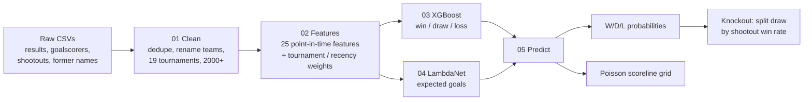
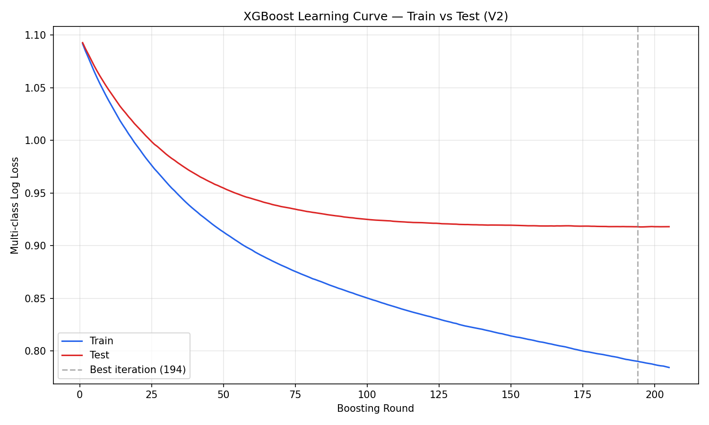
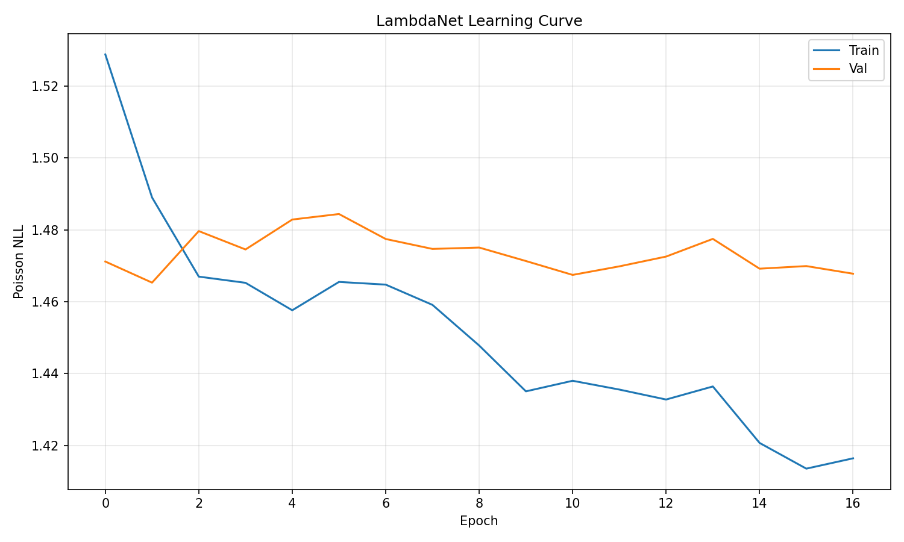
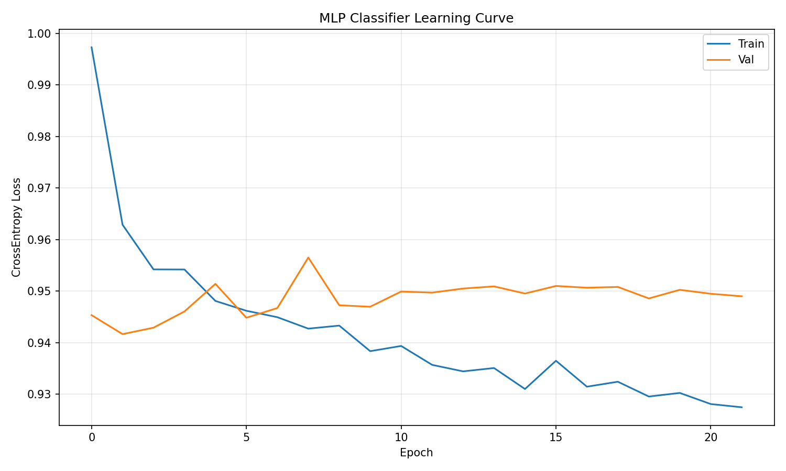

# WC 2026 match predictor

Predicts international match outcomes (win/draw/loss) and scorelines.

- **XGBoost** classifier gives win/draw/loss probabilities.
- **LambdaNet** (PyTorch) predicts expected goals for each side; a Poisson grid turns those into scoreline probabilities.
- In knockout matches, the draw probability is split between the teams using their shootout win rates.

## How it works



Every feature for a match uses only data from **before** that match's date.

### Model runs

Test-set log loss on a random 80/20 split (lower is better), as recorded in notebook 03.

| Model | Log loss | Notes |
|---|---|---|
| Logistic regression | 0.952 | Baseline |
| **XGBoost (RandomizedSearchCV)** | **0.922** | **Saved model**; tuned with a score that penalises low draw / away recall |
| LightGBM | 0.920 | Side experiment |
| CatBoost | 0.923 | Side experiment |
| PyTorch MLP | 0.932 | Side experiment |
| Random forest | 0.906 | Best log loss, but draw F1 only 0.23 |
| XGBoost without Elo features | 0.945 | Ablation: Elo carries a lot of the signal |

### Knockouts and neutral venues

The model learned a home advantage from ordinary matches, but World Cup games are on neutral ground, so
which team is listed first is arbitrary. `05_predict` therefore predicts both orders for neutral matches and
averages them (`predict_match(..., neutral=True)`, the default), so the answer no longer depends on the order.
It also splits a predicted draw 50/50 between the teams, because the shootout win rate did not beat a coin flip.

Backtest (`06_backtest`, each model trained only on earlier matches):

| Test | Before | After |
|---|---|---|
| World Cup knockouts 2014/18/22/26, log loss of "who advanced" (71 games) | 0.655 | **0.620** |
| Same games, accuracy | 59% | 70% |
| All neutral-venue matches 2018-2026, 3-class log loss (1,421 games) | 0.944 | **0.932** |
| Shootout rate vs coin flip, 546 shootouts since 1990, log loss | 0.709 vs 0.693 | no better than a coin flip |

The knockout sample is small (the 95% interval for the improvement is -0.066 to -0.003), so treat that
row as encouraging rather than proven. The larger neutral-venue test points the same way. The scoreline
grid and `LambdaNet` averaging were not tested separately.

These scores are optimistic: Optuna and early stopping used the same test set that is reported.

**XGBoost learning curve.** This curve is from the Optuna-tuned model (cell 12 of notebook 03), not the
final `RandomizedSearchCV` model. Test loss flattens near round 194 while train loss keeps falling.



**LambdaNet learning curve** (Poisson loss). Early stopping triggered at epoch 17. Validation loss barely
improves, while train loss keeps dropping.



**MLP classifier learning curve** (side experiment in notebook 03). Validation loss is flat after the first
few epochs.



## Setup

```bash
python3 -m venv .venv && source .venv/bin/activate
pip install -r requirements.txt
# macOS only, needed by XGBoost / LightGBM:
brew install libomp
```

## Data

The `data/` folder is gitignored, so you need to create it. Layout:

```
data/
  raw/
    results_new.csv        # see below
    goalscorers.csv
    shootouts.csv
    former_names.csv
  processed/               # created by the notebooks
  wc2026/                  # created by the notebooks
```

**Where it comes from:** the public *International football results from 1872* dataset
(Mart Jurisoo): <https://www.kaggle.com/datasets/martj42/international-football-results-from-1872-to-2017>
or <https://github.com/martj42/international_results>.

Download `results.csv`, `goalscorers.csv`, `shootouts.csv` and `former_names.csv`.
Save a copy of `results.csv` as **`results_new.csv`**; that is the filename the notebooks read.
Use a download that includes the matches you want to train on and predict.

Unplayed fixtures are rows with empty scores in `results_new.csv`. Notebook 01 sets them aside as
`data/wc2026/upcoming_fixtures.csv`, which notebook 05 predicts.

> **Warning:** notebook 01 rewrites `data/raw/goalscorers.csv` and `data/raw/shootouts.csv` in place
> (team names are remapped). To start over, re-download them.

## Run order

Start Jupyter from the `code/` folder (paths are relative to it):

```bash
cd code && jupyter lab
```

| Notebook | What it does | Writes |
|---|---|---|
| `01_data_prep` | Clean and filter matches, remap former team names | `data/processed/clean_matches.csv`, `data/wc2026/upcoming_fixtures.csv` |
| `02_feature_engineering` | Build the point-in-time feature matrix | `data/processed/feature_matrix.csv` |
| `03_train_xgboost` | Logistic regression baseline, XGBoost tuning, comparisons | `models/xgboost_final_model.json` |
| `04_train_lambdanet` | Train the expected-goals network | `models/best_lambda_model.pth`, `models/scaler.pkl` |
| `05_predict` | Predict fixtures and knockout rounds | `predictions/*.csv` |
| `06_backtest` | Check the knockout step and neutral-venue handling against past tournaments | nothing |

`features.py` holds all feature functions plus the feature column lists (`ALL_FEATURE_COLS`, 25 columns
in the feature matrix; `FEATURE_COLS`, the 23 the models use).

`code/archive/` holds earlier data-prep notebooks. They are no longer part of the pipeline.
